  

📫 <a href="mailto:1228suhyun@naver.com">1228suhyun@naver.com</a>

## About Me

**AI 결과를 검증하고, 실패에 대비해 서비스로 만드는 개발자입니다.**

- 반도체 장비 회사에서 Wafer tester 보드 불량을 측정 데이터로 진단하고, Linux 장비 환경의 반복 작업을 Python 도구로 줄이며 개발을 시작했습니다.
- LLM 문서 처리 웹앱, 드리프트를 감지하고 재학습하는 ML 시스템, CNN 결함 분류 모델을 직접 만들어 배포했습니다.
- 팀 프로젝트에서는 Spring Boot 백엔드·보안과 React 화면을 맡았고, 지금은 LangGraph 에이전트를 개발하고 있습니다.
- 모델이 좋아 보일 때 평가 방식부터 의심하고, AI가 실패해도 사용자 데이터는 지키는 구조를 먼저 설계합니다.

  

## Projects

| | 프로젝트 | 한 줄 소개 |
|---|---|---|
| 01 | [Cluvelle](https://github.com/dkfjalsj/Cluvelle) | LangGraph 미스터리 수사 에이전트 (진행 중) |
| 02 | [Datasheet-Assistant](https://github.com/dkfjalsj/datasheet-assistant) | 전자부품 데이터시트 분석·비교 LLM 웹앱 |
| 03 | [Mindot](https://github.com/dkfjalsj/project_mindot) | AI 감정 기록 서비스 (백엔드·보안) |
| 04 | [MealFit](https://github.com/axioe/MealFit) | 냉장고 재고 기반 AI 식단 추천 (재고 API·화면) |
| 05 | [LinkUs](https://github.com/dkfjalsj/project_linkus) | 지도 기반 지역 커뮤니티 (프론트엔드) |
| 06 | [Gas Sensor Drift](https://github.com/dkfjalsj/Gas-Sensor-Drift-Classification) | 센서 드리프트 감지·재학습 ML 시스템 |
| 07 | [Metal Surface Defect](https://github.com/dkfjalsj/metal-surface-defect) | 금속 표면 결함 분류 CNN · Grad-CAM |

## Tools

  

