  

  
  
  

## About Me

**AI 결과를 검증하고, 실패에 대비해 서비스로 만드는 개발자입니다.**

- 반도체 장비 회사에서 Wafer tester 보드 불량을 측정 데이터로 진단하고, Linux 장비 환경의 반복 작업을 Python 도구로 줄이며 개발을 시작했습니다.
- LLM 문서 처리 웹앱, 드리프트를 감지하고 재학습하는 ML 시스템, CNN 결함 분류 모델을 직접 만들어 배포했습니다.
- 팀 프로젝트에서는 Spring Boot 백엔드·보안과 React 화면을 맡았고, 지금은 LangGraph 에이전트를 개발하고 있습니다.
- 모델이 좋아 보일 때 평가 방식부터 의심하고, AI가 실패해도 사용자 데이터는 지키는 구조를 먼저 설계합니다.

  

## Projects

### [Cluvelle](https://github.com/dkfjalsj/Cluvelle) · LangGraph 미스터리 수사 에이전트 `개인 · 진행 중`
- 제한된 조사 예산(10회) 안에서 에이전트가 조사 도구 5개 중 다음 행동을 골라 단서를 수집
- 확보하지 않은 증거는 보고서에 인용할 수 없도록 서버에서 증거 ID 검증
- 고정 계획형과 적응형 에이전트를 같은 조건으로 비교하는 평가 설계
- React(Vercel)·FastAPI(Render) 분리 배포, GitHub Actions CI 통과 후 deploy hook 배포

`Python` `LangGraph` `Gemini API` `FastAPI` `Pydantic` `React` `TypeScript` `Vite` `GitHub Actions` `Vercel` `Render`

### [Datasheet-Assistant](https://github.com/dkfjalsj/datasheet-assistant) · 전자부품 데이터시트 분석·비교 LLM 웹앱 `개인`
- Table Transformer로 PDF 표 위치·행열을 인식하고, Gemini로 규격 6개를 값·단위·측정 조건으로 구조화
- 응답 부품번호·단위를 서버에서 재확인하고, 확인할 수 없는 값은 지어내지 않고 '알 수 없음' 처리
- 정답 기준표 대비 일치 18 → 27/36, 신규 데이터시트 정상 응답 48/48, 한국어 질문 의도 테스트 8/8
- 두 부품 비교와 대체 가능성 질의응답, Streamlit 배포

`Python` `PyMuPDF` `PyTorch` `Transformers (Table Transformer)` `Gemini API` `pandas` `Streamlit`

### [Mindot](https://github.com/dkfjalsj/project_mindot) · AI 감정 기록 서비스 `3인 · 백엔드·보안`
- API 64개, 엔티티 15개 백엔드 설계·구현
- 원문 저장과 AI 호출 트랜잭션을 분리하고 실패 작업을 기록·재처리해, AI 장애 시 원문이 유실되던 지점 3곳 제거
- JWT + Redis Refresh Token Rotation, API 51개에 인증 정보 기반 소유권 검증 적용
- pgvector 유사 사례 검색, 주간·월간 리포트, 백엔드 테스트 37/37 통과

`Java` `Spring Boot` `Spring Security` `JPA` `PostgreSQL (pgvector)` `Redis` `FastAPI` `Docker`

### [MealFit](https://github.com/axioe/MealFit) · 냉장고 재고 기반 AI 식단 추천 `6인 · 재고 API·화면`
- 재고 API(입고·조정·폐기·변경 이력)와 냉장고·추천·장보기·레시피 화면 구현
- Spring–Flask–Gemini 구조로 추천을 연동하고, AI 제안을 서버에서 재고·알레르기 기준으로 검증
- ChatGPT(설계)·Codex(구현)·본인(검증)으로 역할을 나눠 개발
- 사용자 흐름 점검으로 동시 추천 중복 생성(6 → 3개)과 범위 초과 시 서버 오류(500 → 400) 수정

`Java` `Spring Boot` `JPA` `MariaDB` `Flyway` `React` `TanStack Query` `Flask` `Gemini API` `Docker`

### [LinkUs](https://github.com/dkfjalsj/project_linkus) · 지도 기반 지역 커뮤니티 `4인 · 프론트엔드 + 관리 백엔드`
- 로그인·회원가입, 카카오·구글 로그인, 마이페이지, 게시글·채팅 신고 화면 구현
- 관리자 페이지(회원·게시글·채팅·신고 관리)와 탈퇴·제재 회원 처리 백엔드 담당
- Redis TTL로 회원 정지 기간 관리

`React` `Vite` `Zustand` `Axios` `Kakao Maps SDK` `Spring Boot` `JPA` `MySQL` `Redis`

### [Gas Sensor Drift Classification](https://github.com/dkfjalsj/Gas-Sensor-Drift-Classification) · 센서 드리프트 감지·재학습 ML 시스템 `개인`
- UCI 가스 센서 데이터(13,910건, 6종 가스) 분류
- 랜덤 분할 Macro F1 0.98이 시간순 평가에서 0.29~0.58로 떨어지는 것을 확인하고 시간순 평가를 기준으로 채택
- 정답 없이 분포 변화를 감지하는 RFF-MMD² 경고와 재학습·승인·롤백 흐름 구현
- pytest 142개, Streamlit 배포

`Python` `scikit-learn` `SciPy` `pandas` `NumPy` `Matplotlib` `Streamlit` `pytest`

### [Metal Surface Defect](https://github.com/dkfjalsj/metal-surface-defect) · 금속 표면 결함 분류 CNN `개인`
- NEU-CLS 1,800장, 6종 결함 분류 · Test 정확도 93.33%, Macro F1 0.9328
- 클래스별 분석으로 가장 약한 Scratches(재현율 80%)를 찾고 Grad-CAM으로 오분류 반응 영역 비교
- GAP 경량화 비교(파라미터 −98%, 정확도 −4.07%p) 후 분류 성능을 우선해 Baseline 유지
- 이미지 업로드·분류·Grad-CAM을 제공하는 Streamlit 웹앱 배포

`Python` `TensorFlow` `Keras` `NumPy` `pandas` `scikit-learn` `Matplotlib` `Streamlit`

## Tools

  

## Contact

📫 1228suhyun@naver.com
